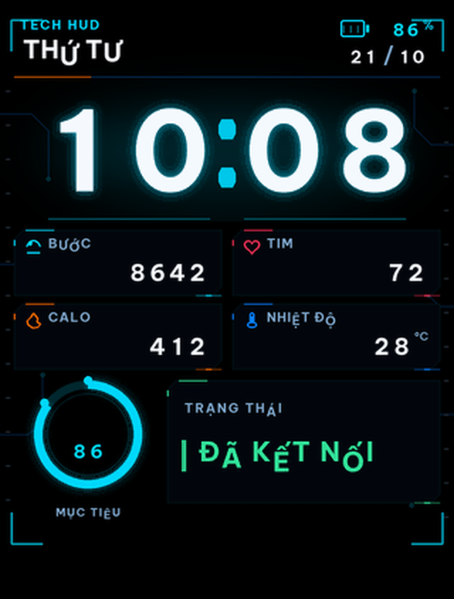

# Redmi Watch 5 Active — Tech HUD VI

Mặt đồng hồ tuỳ chỉnh phong cách **Tech HUD / cyberpunk**, giao diện tiếng Việt có dấu, dành riêng cho **Xiaomi Redmi Watch 5 Active** (320 × 385, DeviceType `3651`).



> Ảnh xem trước dùng **số liệu minh họa**. Trên đồng hồ, các giá trị lấy từ cảm biến và ứng dụng điện thoại đã kết nối.

---

## 1. Giới thiệu

Dự án tạo ra một mặt đồng hồ số thực thụ bằng compiler Gen2, không phải mockup:

- Đồng hồ số `HH:MM` cỡ lớn, độ tương phản cao, có glow cyan tiết chế.
- Khung HUD góc vát, đường mạch điện tử, panel thông số và vòng tiến độ.
- Bố cục tối giản: chỉ giữ dữ liệu cần thiết, không footer tên máy, không mã phiên bản, không nhãn đơn vị lặp.
- Toàn bộ nhãn và chữ số được **rasterize thành bitmap** bằng font **Be Vietnam Pro**, nên không phụ thuộc font hệ thống của đồng hồ và không mất dấu.
- Dữ liệu động lấy từ các source đã được tài liệu hoá cho đúng mẫu máy.
- Build, kiểm tra, đóng gói và phát hành tự động bằng GitHub Actions.

### Bảng màu

| Vai trò | Mã |
|---|---|
| Nền | `#000000` |
| Cyan | `#00D9FF` |
| Xanh điện | `#087EFF` |
| Cam | `#FF6B00` |
| Đỏ | `#FF3158` |
| Xanh lá | `#32E69B` |
| Chữ sáng | `#F5FAFF` |
| Chữ phụ | `#7FA7CC` |

---

## 2. Trạng thái hỗ trợ thiết bị

| Hạng mục | Trạng thái |
|---|---|
| Thiết bị đích | Redmi Watch 5 Active |
| DeviceType | `3651` |
| Độ phân giải | 320 × 385 |
| Compiler | Mi Create `compile.exe`, pin commit + SHA-256 |
| Build on CI | GitHub Actions `windows-2022` |
| Kiểm tra cấu trúc `.bin` | Có, tự động |
| **Kiểm thử trên máy thật** | **Chưa thực hiện** |
| Kênh phát hành | **Pre-release** cho tới khi có xác nhận thiết bị |

> Chưa có bằng chứng cài đặt và hiển thị trên Redmi Watch 5 Active thật. Vì vậy mọi release hiện tại là **pre-release**. Xem [docs/device-test.md](docs/device-test.md) để biết cách xác nhận.

### Vì sao không có ô KM?

Danh sách data source cho `redmi_watch_5_active` trong Mi Create **không có** nguồn quãng đường. Định dạng này cũng không cho phép tính toán trên thiết bị. Dự án **không** hiển thị KM giả và không suy ra quãng đường từ số bước. Vì vậy bố cục dùng 4 panel: **BƯỚC, TIM, CALO, NHIỆT ĐỘ**; mục tiêu bước chân nằm ở vòng tiến độ.

### Nguồn dữ liệu thực tế

| Thành phần | Source | Ghi chú |
|---|---|---|
| Giờ | `1000911`, `0911`, `1211`, `1111` | 4 chữ số tách riêng |
| Thứ | `2012` | 7 ảnh tên đầy đủ: CHỦ NHẬT, THỨ HAI, THỨ BA, THỨ TƯ, THỨ NĂM, THỨ SÁU, THỨ BẢY |
| Ngày / tháng | `1812`, `1012` | hiển thị dạng `21/10` |
| Pin | `0841` | phần trăm |
| Bước | `0821` | |
| Nhịp tim | `0822` | |
| Calo | `0823` | |
| Nhiệt độ | `2031` | do ứng dụng điện thoại cung cấp |
| Mục tiêu | `1021` | % mục tiêu bước chân |
| Trạng thái | `2041` | kết nối Bluetooth |

Không có dữ liệu nào được sinh ngẫu nhiên hay gán cứng trong mặt đồng hồ.

---

## 3. Cài đặt

Chỉ sử dụng phương pháp đã được cộng đồng ghi nhận cho **đúng mẫu Redmi Watch 5 Active**. Mi Fitness chỉ cài mặt từ catalogue của Xiaomi; file `.bin` không cài trực tiếp qua Mi Fitness.

1. Đồng hồ đã ghép nối với Mi Fitness. **Không unpair hoặc reset** sau bước này — khoá mà Notify đọc sẽ thay đổi.
2. Trong Mi Fitness: **Hồ sơ → Giới thiệu ứng dụng → chạm logo 10 lần → xác nhận**. File zip được lưu trong `Download/wearablelog`.
3. Cài **Notify for Xiaomi** từ Google Play.
4. Trong Notify, chọn nhập từ ứng dụng chính thức → **Import file** → chọn thư mục `Download/wearablelog` → **Use this folder** → chọn đúng model.
5. Khi Notify yêu cầu, tắt toàn bộ quyền của Mi Fitness (không gỡ ứng dụng).
6. Tải `tech-hud-vi.bin` từ [Releases](../../releases).
7. Trong Notify: **Thiết bị → Mặt đồng hồ → menu phụ → Custom watch face (.bin)** → chọn file → **Install** → chấp nhận cảnh báo tương thích → **Install** lần nữa.
8. Trên đồng hồ, nhấn giữ mặt hiện tại và vuốt tới mặt mới.

Lưu ý:

- Đồng hồ chỉ chứa được khoảng một mặt tuỳ chỉnh bên cạnh các mặt có sẵn. Xoá bớt mặt đã tải nếu báo **“Not enough space”**.
- Nếu đồng hồ khởi động lại khi chọn mặt: nó quay về mặt mặc định, không mất dữ liệu. Hãy xoá mặt đó và báo lỗi.
- **Gadgetbridge** hiện không cài được mặt `.bin` cho mẫu này.
- Không có cách cài từ iPhone.
- Nhiệt độ phụ thuộc ứng dụng đang kết nối (Notify), không phải cảm biến trên đồng hồ.

### Quay về mặt mặc định

- Nhấn giữ mặt đồng hồ → chọn một mặt có sẵn.
- Hoặc xoá mặt tuỳ chỉnh đã cài.
- Không cần flash firmware, không cần root, không đụng bootloader.

---

## 4. Build thủ công

Yêu cầu: Python 3.11+, và **Windows** (hoặc Linux + Wine) để chạy compiler.

```bash
python3 -m venv .venv
. .venv/bin/activate
pip install -r requirements.txt

python3 scripts/generate_assets.py
python3 scripts/validate_target.py
python3 scripts/validate_assets.py
python3 -m pytest -q
```

### Chỉ tạo preview và source package (không cần compiler)

```bash
python3 scripts/package_release.py --version v1.0.2
```

Kết quả nằm trong `dist/`. Khi không có compiler, **không** có `tech-hud-vi.bin`; script ghi rõ điều đó trong `BUILD-INFO.txt`.

### Build file cài đặt thật

1. Tải compiler đã pin:
   ```text
   https://raw.githubusercontent.com/ooflet/Mi-Create/586a917dec69626447254adc965daabb97fb30dc/src/compiler/compile.exe
   ```
2. Kiểm tra SHA-256:
   ```text
   bf0f7230f4fd08ed45d9a9fd1b8359a679b04b87998825a259e0ef49ba239f30
   ```
3. Đặt tại `compiler/compile.exe` hoặc đặt biến `WATCHFACE_COMPILER`.
4. Chạy:
   ```bash
   python3 scripts/build_watchface.py
   ```

Script chạy compiler thật với tham số:

```text
compile.exe -b src/watchface/tech_hud_vi.fprj dist tech-hud-vi.bin 1461256429
```

Sau đó kiểm tra magic `5AA53412`, phiên bản `0x00010000`, bảng resource nằm trong file, tiêu đề mặt đồng hồ và entropy. Chỉ khi tất cả đạt, file mới được copy vào `dist/tech-hud-vi.bin`.

Compiler là công cụ bên thứ ba, **không Open Source**, không được phân phối trong repo này. Pin commit + SHA-256 để bảo đảm tính toàn vẹn.

---

## 5. GitHub Actions

Workflow: `.github/workflows/build-watchface.yml`

Trigger:

- `push` lên `main`
- `pull_request`
- `workflow_dispatch`
- tag `v*`

Các job:

1. **source** (Ubuntu): sinh asset, kiểm tra thiết bị, kiểm tra font/glyph tiếng Việt, chạy test, tạo preview + source zip + checksum, upload artifact.
2. **compiler** (Windows): tải `compile.exe` đã pin, xác minh SHA-256, biên dịch thật, kiểm tra nhanh phần header, upload `tech-hud-vi.bin`.
3. **release** (chỉ tag `v*` hoặc dispatch có `release=true`): tải artifact, xác minh binary, tạo lại checksum đầy đủ, kiểm tra tag/release chưa tồn tại, tạo GitHub Release.

Quyền:

- Mặc định `contents: read`.
- Chỉ job `release` có `contents: write`.
- Không chạy compiler trên pull request từ fork.
- Không lưu token trong repo.

### Tải artifact

Mở tab **Actions** → chọn run → mục **Artifacts**:

- `tech-hud-vi-source`: preview, source zip, checksum, build info.
- `tech-hud-vi-bin`: file `.bin` đã biên dịch và kiểm tra.

Artifact của pull request **không** kèm binary.

### Phát hành

```bash
# Tag phát hành (pre-release tự động vì chưa test thiết bị)
git tag v1.0.2
git push origin v1.0.2
```

Hoặc **Actions → build-watchface → Run workflow**, nhập tag đã tồn tại và chọn `release=true`.

Quy tắc:

- Không ghi đè tag/release đã có.
- Build lỗi → không tạo release.
- Thiếu binary → job release thất bại.
- Stable chỉ được phép khi `tests/device_verification.json` có `"verified": true`.

---

## 6. Xác minh checksum

```bash
sha256sum -c SHA256SUMS.txt
```

Hoặc trên Android/Termux:

```bash
sha256sum tech-hud-vi.bin
grep tech-hud-vi.bin SHA256SUMS.txt
```

---

## 7. Cấu trúc dự án

```text
.
├── assets/
│   ├── backgrounds/        # background 320x385
│   ├── fonts/              # Be Vietnam Pro (OFL)
│   ├── icons/              # icon SVG nguồn
│   ├── source/             # SVG khung HUD
│   └── manifest.json       # hash của asset sinh ra
├── design/
│   ├── layout.json         # nguồn thiết kế duy nhất
│   └── preview.png         # preview có ghi chú minh họa
├── docs/                   # nghiên cứu định dạng, pin compiler, test thiết bị
├── scripts/                # sinh asset, kiểm tra, build, đóng gói
├── src/watchface/          # .fprj + toàn bộ bitmap
├── tests/                  # pytest + trạng thái test thiết bị
├── dist/                   # output (gitignore)
└── .github/workflows/
```

`design/layout.json` là nguồn duy nhất. Chạy lại `generate_assets.py` sẽ tạo lại toàn bộ bitmap, `.fprj` và preview.

---

## 8. Giới hạn đã biết

- **Chưa kiểm thử trên thiết bị thật.** Đây là giới hạn quan trọng nhất.
- Không có AOD.
- Không có quãng đường KM (không có source được tài liệu hoá).
- Nhiệt độ có thể trống nếu ứng dụng điện thoại chưa đồng bộ thời tiết.
- Chưa đo mức hao pin và khả năng đọc ngoài trời trên máy thật.
- Một số máy có thể báo “Not enough space” nếu đã có mặt tuỳ chỉnh khác.
- Compiler đóng; hành vi có thể thay đổi nếu dùng phiên bản khác. Luôn dùng đúng SHA-256 đã pin.

---

## 9. Nghiên cứu tham khảo

- [m0tral/EasyFace](https://github.com/m0tral/EasyFace) — editor/compiler Gen2, hướng dẫn thay file cho Redmi Watch 5 Active/Lite.
- [ooflet/Mi-Create](https://github.com/ooflet/Mi-Create) — định nghĩa device `redmi_watch_5_active`, source list, compiler `compile.exe`, hỗ trợ Wine.
- [m0tral/MiWatchLuaWatchfaces](https://github.com/m0tral/MiWatchLuaWatchfaces) — project `.fprj` mẫu cho đúng `RedmiWatch5_Active`, dùng để xác nhận DeviceType `3651` và cấu trúc XML.
- [xag/watch-faces](https://github.com/xag/watch-faces/tree/main/redmi-watch-5-active) — quy trình cài bằng Notify và file `.bin` mẫu.
- [Byterialab/xiaomi-smart-watch-research](https://github.com/Byterialab/xiaomi-smart-watch-research) — nghiên cứu định dạng, magic `5AA53412`, resource table và các lỗi biên. Dự án này **không** sử dụng payload khai thác.

Chi tiết quyết định kỹ thuật: [docs/format-research.md](docs/format-research.md).

---

## 10. Giấy phép

- Mã nguồn, thiết kế, script: **MIT** — xem [LICENSE](LICENSE).
- Font **Be Vietnam Pro**: SIL Open Font License 1.1, bản quyền thuộc tác giả font. Xem `assets/fonts/OFL-BeVietnamPro.txt`. File Orbitron còn trong thư mục font nhưng không còn được dùng để render kể từ v1.0.2.
- Compiler `compile.exe`: công cụ bên thứ ba, **không** thuộc dự án và **không** được phân phối lại.

Dự án không can thiệp bootloader, root, firmware hệ thống hoặc khai thác lỗ hổng bảo mật.
